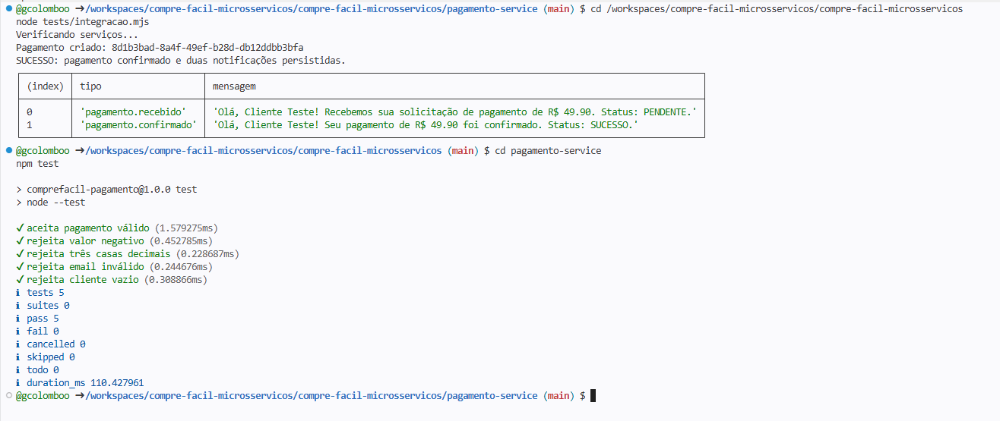

# CompreFácil — Desafio 2: Desenvolvimento de Sistemas Distribuídos

Projeto acadêmico demonstrativo com **dois microsserviços Node.js independentes**, PostgreSQL, RabbitMQ (AMQP), REST e Docker Compose. Simula pagamentos: **não realiza cobranças reais** e **não envia e-mails reais**.

## Requisitos

- Docker Desktop ou Docker Engine + Docker Compose v2 (`docker compose`)
- Para o teste automatizado fora do Docker: Node.js 20 ou superior

## Executar

Na pasta raiz:

```bash
docker compose up --build -d
docker compose ps
```

A primeira inicialização pode demorar alguns minutos. Verifique `docker compose ps` e aguarde os serviços iniciarem.

| Serviço | Endereço |
|---|---|
| Pagamentos REST | http://localhost:3000 |
| Notificações REST | http://localhost:3001 |
| RabbitMQ Management | http://localhost:15672 (usuário `compre`, senha `compre_dev`) |
| PostgreSQL | localhost:5432 (usuário `compre`, senha `compre_dev`, banco `comprefacil`) |

**Atenção:** portas e credenciais são exclusivamente para desenvolvimento local. Não exponha esse Compose à internet.

## Fluxo assíncrono exigido

1. `POST /pagamentos` valida os dados e grava no PostgreSQL com status `PENDENTE`.
2. O pagamento registra o evento `pagamento.recebido` em uma tabela *outbox* e o publica no RabbitMQ.
3. O microsserviço de notificações consome o evento e grava/exibe uma notificação simulada de recebimento.
4. Um consumidor AMQP **do próprio serviço de pagamentos** recebe o trabalho de processamento, aguarda o evento inicial ser publicado e atualiza a transação para `SUCESSO`.
5. O pagamento registra e publica o evento `pagamento.confirmado`.
6. O serviço de notificações consome o evento e grava/exibe a notificação de confirmação.

A API responde `202 Accepted` enquanto o processamento ocorre em segundo plano. O consumidor de notificações não chama a API de pagamentos. Ambos executam em processos e containers separados. A outbox reduz o risco de perda de eventos quando o broker fica temporariamente indisponível; mensagens podem ser repetidas, por isso notificações usam `evento_id` único para deduplicação.

**Limitações didáticas:** o pagamento é sempre aprovado, não existe gateway financeiro real; a notificação é simulada em logs e no banco (não envia e-mail/SMS); não há autenticação, criptografia de dados pessoais em repouso ou infraestrutura de produção. A fila de processamento é enviada após o commit; uma interrupção exatamente entre o commit e a publicação pode deixar um pagamento pendente sem processamento automático. Para produção, o trabalho também deve usar outbox/recuperação, dead-letter queues e monitoramento.

## Testar manualmente

**Criar transação** (Postman: método POST, URL `http://localhost:3000/pagamentos`, Body → raw → JSON):

```json
{
  "cliente": "Maria Silva",
  "email": "maria@example.com",
  "valor": 129.90
}
```

Resposta esperada: HTTP `202` e objeto com `id` (UUID) e `status: "PENDENTE"`.

**Consultar transação:** `GET http://localhost:3000/pagamentos/SEU_ID` (após alguns segundos, `SUCESSO`).

**Consultar notificações:** `GET http://localhost:3001/notificacoes?pagamentoId=SEU_ID` (duas notificações: `pagamento.recebido` e `pagamento.confirmado`).

**Outras rotas:**

- `GET /pagamentos` — últimas 100 transações (porta 3000)
- `GET /health` — saúde do serviço (ambas as portas)
- `GET /notificacoes` — últimas 100 notificações (porta 3001)

**Logs das notificações:**

```bash
docker compose logs -f notificacao
```

## Testes automatizados

Com os containers ativos e Node.js 20+ instalado no computador:

```bash
node tests/integracao.mjs
```

Esse teste verifica saúde, validação de entrada, criação de pagamento, mudança de status e as **duas notificações** (aguarda até 30 segundos).

Testes unitários de validação:

```bash
cd pagamento-service
npm test
```

## Evidências de execução e testes

O projeto foi executado no GitHub Codespaces com Docker Compose. Na validação realizada em 22/11/2026:

- `docker compose up --build -d`: imagens construídas; containers `pagamento` e `notificacao` em execução; PostgreSQL e RabbitMQ com status `healthy`.
- `node tests/integracao.mjs`: **aprovado**. O teste criou um pagamento, verificou a transição `PENDENTE` → `SUCESSO` e confirmou o registro de duas notificações: `pagamento.recebido` e `pagamento.confirmado`.
- `cd pagamento-service && npm test`: **5 testes aprovados, 0 falhas**, incluindo pagamento válido, valor negativo, três casas decimais, e-mail inválido e cliente vazio.

Esses resultados são registros de uma execução de teste, não uma garantia de disponibilidade permanente dos serviços.

### Captura de tela dos testes



A captura apresenta a confirmação do pagamento, as duas notificações e o resumo dos cinco testes unitários aprovados.

## Parar e limpar

```bash
docker compose down
```

Para apagar também **todos os dados de desenvolvimento**:

```bash
docker compose down -v
```

## Estrutura

```text
compre-facil/
├── docker-compose.yml
├── pagamento-service/
│   ├── Dockerfile
│   ├── package.json
│   └── src/
│       ├── index.js
│       ├── validation.js
│       └── validation.test.js
├── notificacao-service/
│   ├── Dockerfile
│   ├── package.json
│   └── src/index.js
├── tests/integracao.mjs
├── .env.example
└── README.md
```

## Repositório e entrega

O projeto já está publicado no GitHub:

**https://github.com/gcolomboo/compre-facil-microsservicos**

Para trabalhar localmente com os arquivos publicados:

```bash
git clone https://github.com/gcolomboo/compre-facil-microsservicos.git
cd compre-facil-microsservicos
docker compose up --build -d
docker compose ps
node tests/integracao.mjs
```

**Importante:** execute o teste de integração somente depois de os quatro containers estarem prontos. O GitHub armazena o código, mas o teste com PostgreSQL e RabbitMQ precisa ser executado em um ambiente com Docker.

Para enviar futuras alterações pelo terminal:

```bash
git add .
git commit -m "Atualiza projeto CompreFacil"
git push
```

Entregue no AVA o link do repositório acima.

## Critérios de avaliação

- **Serviços independentes:** duas aplicações Node.js com containers, portas e responsabilidades próprias.
- **Mensageria assíncrona:** RabbitMQ com filas duráveis, AMQP, exchange e eventos.
- **Fluxo de pagamento:** PENDENTE → evento recebido → notificação → SUCESSO → evento confirmado → notificação.

Projeto de demonstração desenvolvido para o desafio acadêmico da empresa fictícia CompreFácil.
